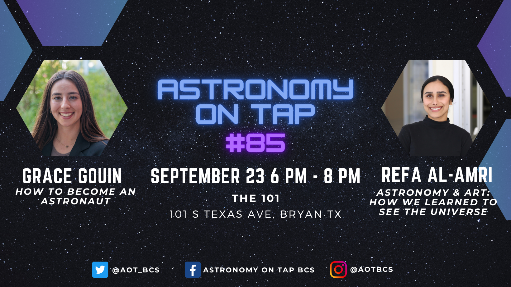

<figure>

</figure>

<table class="tg" style="undefined;table-layout: fixed; width: 100%"><colgroup>
<col style="width: 25%">
<col style="width: 75%">
</colgroup>
<tbody>
  <tr>
    <td class="tg-9l91">Summary:</td>
    <td class="tg-60hs"> In this talk, we’ll explore how astronomy and art have shaped the way we see the universe, from early illustrations of the night sky to the stunning images captured by modern telescopes. We’ll look at how advances in science and technology have changed the way we visualize the cosmos, and how art helps us turn astronomical data into the images we know today.  </td>
  </tr>
  <tr>
    <td class="tg-9l91">Date </td>
    <td class="tg-60hs">January 28, 2026.</td>
  </tr>
  <tr>
    <td class="tg-9l91">Event</td>
    <td class="tg-60hs">Astronomy on Tap BCS.</td>
  </tr>
  <tr>
    <td class="tg-9l91">Location</td>
    <td class="tg-60hs">The 101,  101 S TEXAS AVE,  BRYAN TX.</td>
  </tr>
</tbody></table>