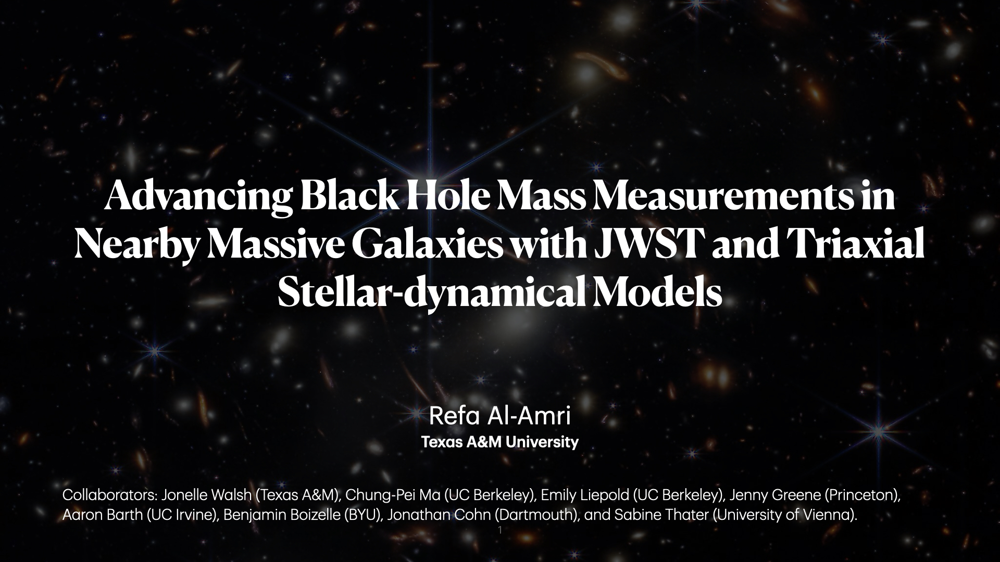

<figure>

</figure>

<table class="tg" style="undefined;table-layout: fixed; width: 100%"><colgroup>
<col style="width: 25%">
<col style="width: 75%">
</colgroup>
<tbody>
  <tr>
    <td class="tg-9l91">Abstract</td>
    <td class="tg-60hs">About 150 supermassive black hole (BH) masses have been dynamically measured in nearby galaxies, but the local BH census remains highly incomplete. As a result, the slope, scatter, and even the shape of the BH-host galaxy relations are still uncertain, particularly at the high-mass end. In addition, only a small number of studies have directly compared BH masses derived from different dynamical tracers or modeling assumptions, with mixed results. In this talk, we focus on two local ellipticals, M87 and NGC 4261, which anchor the sparsely populated upper end of the BH mass distribution. A wide range of BH mass measurements has been reported for M87 over the past four decades using multiple methods, whereas NGC 4261 was the target of one of the earliest HST ionized-gas dynamical studies and now has a very precise BH mass from ALMA molecular-gas observations. We present exquisite high angular resolution spectra at the center of both galaxies from the JWST NIRSpec IFU, large-scale stellar kinematics measured with Keck KCWI and VLT MUSE, and stellar-dynamical models that make use of a recently revamped triaxial orbit code and modern search strategies to simultaneously determine mass and galaxy intrinsic shape parameters. Such work is a necessary step towards obtaining robust dynamical BH masses, evaluating the consistency of the main measurement techniques and subsequent effects on the BH scaling relations, and advancing our understanding of the growth of high-mass galaxies and their central BHs.. </td>
  </tr>
  <tr>
    <td class="tg-9l91">Date </td>
    <td class="tg-60hs">June 30, 2026.</td>
  </tr>
  <tr>
    <td class="tg-9l91">Event</td>
    <td class="tg-60hs">Supermassive Black Holes and Blue Notes.</td>
  </tr>
  <tr>
    <td class="tg-9l91">Location</td>
    <td class="tg-60hs">University of Montreal, Montreal, Quebec, Canada.</td>
  </tr>
</tbody></table>